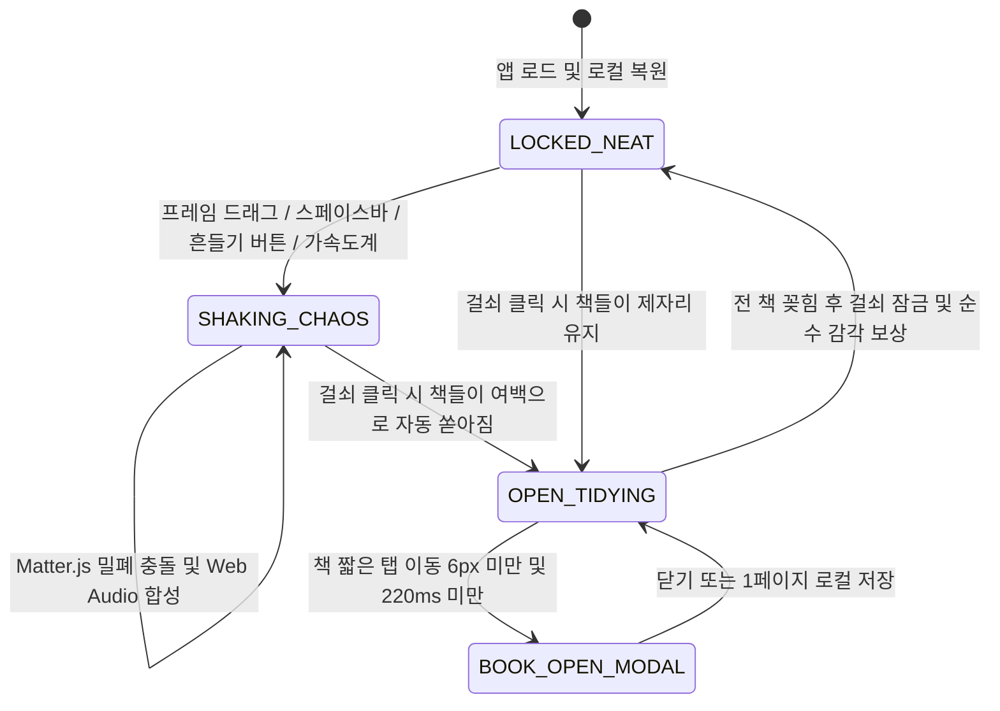

# 비우어 (biueo) — Master Implementation Plan (v3)

> [!IMPORTANT]
> 본 문서는 컨텍스트 유실 시에도 설계 의도, 뇌과학 근거, 시각 규칙, 비목표(Non-Goals), Phase 0 게이트 판정, Phase 1-4 상세 구현 설계를 100% 복원할 수 있는 마스터 계획서입니다.
> 동결된 TypeScript 타입, IndexedDB·JSON v1 스키마, Engine↔UI API, 정규화 좌표, 터치 보정·물리 분기, 질서 감지 수식, 한국어 문구는 [CONTRACTS.md](file:///c:/project/sub-proj/docs/CONTRACTS.md)에, 진행 현황은 [PROGRESS.md](file:///c:/project/sub-proj/docs/PROGRESS.md)에 기록합니다.

---

## 1. Goal Description

**비우어(biueo)**는 검증된 인지신경과학·긍정심리학 기전을 바탕으로, 사용자가 로그인이나 서버 통신 없이 브라우저에서 즉시 생각을 초기화하고 선택적으로 짧은 자기확언 기록을 남기는 **100% Local-First 웹앱**입니다.

### 핵심 컨셉: 능동적 이완 (Active Reset)
- 단순 피젯 토이(클리커·스피너)는 동작이 기저핵으로 빠르게 자동화되어 전전두엽의 반추 사고(DMN)를 막지 못합니다.
- 실물 '불안 해소 책장(Anxiety Bookshelf)'은 **통제된 파괴(흔들어 쏟기) -> 저강도 시공간 재정렬(색상·높이·두께·자유 배치) -> 마감 의례(유리문 닫고 걸쇠 잠금)** 루프로 작업기억의 시공간 버퍼를 안전하게 선점(preempt)합니다.
- 부트캠프 긍정 리츄얼(강점 회고, 오늘의 행동, 자기격려, 작은 감사)은 비언어 초기화 흐름을 깨지 않도록 **'개별 책을 짧게 탭할 때만 열리는 1페이지 로컬 노트'**로 분기 통합합니다.

### 확정된 10대 제품·UX 결정 (Grilling & Phase 0 Gate 완료)
1. **이완과 리츄얼의 분리**: 기본 드래그는 순수 책장 꽂기(무모달·무입력)로 유지하고, 개별 책을 짧게 탭(`6px 미만`, `220ms 미만`)할 때만 1페이지 리츄얼 노트를 펼칩니다.
2. **책당 1페이지 + 다중 서가 완전 동등성 & 완결 Soft Fork (Vol. 1 ↔ Vol. N)**: 각 책은 1페이지 기록(`note: RitualNote | null`)과 책갈피 리본을 가집니다. 한 서가의 모든 책(36권 또는 60권)이 채워지면 새 서가(Vol. 2)를 `3×3` 또는 `5×3` 프리셋으로 추가할 수 있으며, 이전 서가로 전환해도 읽기 전용 아카이브가 아니라 흔들기·정리·다중 질서 보상·기존 리츄얼 열람 및 수정을 100% 동일하게 수행합니다.
3. **100% 개인 로컬 도구**: 계정·서버 통신·타인 피드 없이 브라우저 `IndexedDB`에 저장하고, JSON 내보내기/불러오기로 백업합니다.
4. **반응형 `3×3` 기본 + `5×3` 대형 프리셋 & 모바일 터치 보정**: 기본 서가는 `3×3`(9칸·36권), 대형 프리셋은 `5×3`(15칸·60권)으로 제공하며, 볼륨 생성 시 크기를 고정합니다. 모바일 세로 화면에서는 `5×3`을 자동으로 **`3×5`(3열 5행)로 전치**해 칸 폭을 유지하고, 터치 입력에는 **28px 근접 자석 선택**과 드래그 중 **손가락 위쪽 `-48px` 들림 오프셋**을 적용합니다.
5. **무실패 계층 감지 + 순수 감각 보상**: 오답 판정과 슬롯 거부를 전면 배제합니다. 칸(4권)·행(12권)·전체(36권)의 5종 질서를 감지하되, 텍스트 라벨·점수·배지 없이 **파스텔 반짝임과 화음 변화**로만 보상합니다.
6. **무랜딩 즉시 진입 + `?` 버튼 도움말 통일 + 1회성 유령 힌트**: 랜딩 페이지와 첫 접속 자동 모달을 모두 두지 않습니다. 도움말(조작법·검증 논문)은 첫 접속부터 상시 모서리 `?` 버튼으로만 열며, 첫 조작 전까지만 비차단 1줄 유령 힌트를 표시했다 즉시 영구 소멸합니다.
7. **유리문 열림 물리 분기**: 흔든 뒤(`SHAKING_CHAOS`) 걸쇠를 열면 무너진 책들이 데스크 여백으로 자동 쏟아져 펼쳐지며, 흔들지 않고 정돈 상태(`LOCKED_NEAT`)에서 걸쇠를 열면 책들이 제자리에 머물러 바로 열람·부분 정리가 가능합니다.
8. **추후 다중 콘텐츠 진입 규칙 (v1 스키마만 예약)**: 2차 콘텐츠 추가 시 고유 경로(`/shelf` 등)와 기본 개방을 보장하며, 재방문은 직전 공간(`lastActiveModuleId`)을 복원하되 수동 랜덤 전환 버튼과 설정의 `openRandomOnVisit`(접속 시 랜덤 진입 옵트인)을 제공합니다. 36/36 완결 시에는 Soft Fork 전환 분기를 제공합니다.
9. **v1 한국어 단일 + 담백한 구어체**: 초기 운영은 한국어에 집중하고, 리츄얼 질문은 부담 없는 짧은 구어체로 통일합니다.
10. **Phase 0 시각 게이트 통과 (외부 에셋 미도입)**: 프로시저럴 Canvas 2D 과슈·리소그래프 질감을 통과(Pass)로 확정하고, Phase 1 진입 시 책등 ±1.2° 기울기와 칸 모서리 점묘 음영만 코드로 보강합니다.

---

## 2. Explicit Non-Goals (하지 말아야 할 것 — 새 세션 필독)

> [!CAUTION]
> 새 세션의 에이전트는 아래 항목을 임의로 추가하지 마십시오.
> - **로그인·회원가입·소셜 피드·서버 DB 구축 금지** (100% 정적 배포 Local-First 유지).
> - **점수, 타이머, 스트릭(연속 출석 압박), 오답 버저, 슬롯 거부, 수집형 별표 도감 금지** (성과 불안 유발 차단).
> - **질서 완성 시 텍스트 토스트·배지·축하 팝업 금지** (순수 감각 보상 원칙).
> - **첫 접속 자동 팝업 모달, 랜딩 페이지, 드래그 정리 중 강제 글쓰기 모달 노출 금지** (비언어 즉시 진입 보호).
> - **의학적 치료·완치·도파민 디톡스 같은 과장 문구 금지** (5편 원논문 범위 내 서술).
> - **`Rough.js`, `PixiJS`, `Three.js`, `ThreeRT`, 외부 PNG 책/책장 에셋 도입 금지** (프로시저럴 Canvas 2D 베이커 유지).
> - **SaaS 대시보드 카드 UI, ALL-CAPS 라벨, 과도한 버튼 크롬, `/init-design-reference` Stage 0-1 스타일 타일 중복 생성 금지** (책장 캔버스가 뷰포트의 80% 이상 점유).
> - **완료된 이전 서가(Vol. 1 등)의 읽기 전용 잠금 금지** (이전 서가도 새 서가와 동일하게 흔들기·정리·기록 열람 가능).
> - **리츄얼 완주 기반 강제 해금(Hard Gate), v1 내 'Coming Soon' 빈 분기, 2차 콘텐츠 리츄얼 강제 상속 금지** (숙제화 방지 및 콘텐츠별 물리 메타포 독립 유지).

---

## 3. Verified Scientific Foundation (요약)

상세 원논문 서지 정보는 `docs/CONTRACTS.md` 7.3절을 따릅니다.
- **Holmes et al. (2009, 2010, *PLoS ONE*)**: 시공간 작업기억 간섭으로 침투 시각 기억 감소. 언어 과제는 오히려 증가 -> 비언어 책장 정리와 언어 리츄얼의 분리 근거.
- **Brooks et al. (2016, *OBHDP*)**: 의례(Ritual) 프레임이 심박수·상태 불안 감소 -> 걸쇠 해제·흔들기·정리·걸쇠 잠금 시퀀스 근거.
- **Cascio, Falk et al. (2016, *SCAN*)**: 자기확언의 mPFC/PCC 및 보상 회로(vmPFC·복측 선조체) 활성, 미래지향적 성찰로 증폭 -> `future_action` 프롬프트 근거.
- **Seligman et al. (2005, *American Psychologist*)**: 대표 강점 활용, Three Good Things, 감사의 장기 안녕감 효과 -> `strength_recall`, `self_compassion`, `gratitude` 프롬프트 근거.
- **Bolier et al. (2013, *BMC Public Health*)**: 39개 RCT 메타분석(주관적 안녕감 g = 0.34, 심리적 안녕감 g = 0.20, 우울 g = 0.23) -> 과장 없는 한계 고지 근거.

---

## 4. Visual Design System (*A Little to the Left* 4장 레퍼런스 기준)

- **화풍**: 무외곽선 과슈·리소그래프(Lineless Gouache / Risograph). 검은 외곽선·빗금 해칭 없음.
- **바탕 테마 4종**: `sage`(`#C7E1B6`), `slate`(`#8F9FA9`), `lavender`(`#7E7E9A`), `charcoal`(`#323C42`).
- **원목 책장**: 자작나무·크림 우드(`#E5D2B5` / 음영 `#C8B08E` / 칸 바닥 `#F3ECE0`) + 황동 걸쇠(`#E2BE68`).
- **책등 9색 팔레트**: `coral`, `salmon`, `butter`, `olive`, `sage`, `slate`, `oat`, `cream`, `charcoal` (`docs/CONTRACTS.md` 1절 참조).
- **렌더링 규칙**: ±0.7px 손재단 미세 굴곡 + 2톤 면 분할 및 6종 기하학 무늬 + fBm 심리스 종이·초크 입자 프리베이킹 + 배경 어두운 단색 오프셋 그림자 + 대각선 흰 광택 띠 유리문 + Phase 1 보강(책등 ±1.2° 미세 기울기, 칸 모서리 점묘 음영).
- **Modern Web Guidance 적용**: `in oklab` 색상 혼합(`isolation: isolate`), 비색상 병행 단서(WCAG 1.4.1), 네이티브 `<dialog>` + `closedby="any"`(Safari 좌표 폴백) + `::backdrop` 스크롤 차단, CSS `linear()` 스프링 이징(`prefers-reduced-motion` 존중), `content-visibility: auto` + `contentvisibilityautostatechange`(`IntersectionObserver` 폴백).

---

## 5. System Architecture & State Machine

- **모듈 경계**: `src/engine/`(순수 TS, React 무의존) ↔ `src/components/`(React 19 얇은 UI 셸) ↔ `src/storage/`(IndexedDB·JSON v1). 상세 시그니처는 `docs/CONTRACTS.md` 3절 참조.

---

## 6. Phased Implementation Blueprint

### Phase 0: Project Bootstrap & Visual Dummy Spike — [DONE / PASS]
- Vite 8 + React 19 + Tailwind CSS v4 + TypeScript + Vitest 스캐폴딩, `src/types/contracts.ts`, 조합론적 36권 덱, fBm 종이·초크 입자 베이커, 3×3 책장·유리문·걸쇠·책갈피 리본 렌더러 완료.
- 검증 통과: `tsc --noEmit` 0 errors, `npm run build` 173ms, `vitest` 6/6 passed, 브라우저 데스크톱(`30.8px`)·모바일(`17.8px`) 검수 완료.

---

### Phase 1: Dual Physics Engine, Touch Ergonomics & Minimal Production Shell — [NEXT TARGET]
**목표**: Phase 0 더미를 실제 흔들고·쏟고·자석 스냅으로 정리할 수 있는 인터랙티브 물리 책장으로 전환하고, Phase 0 튜닝 독을 실제 최소 HUD 및 `?` 도움말 `<dialog>`로 교체합니다.

#### 의존성 추가
- `npm install matter-js` 및 `npm install -D @types/matter-js`

#### [MODIFY] 계약 동기화 & `5×3` 프리셋 · Canvas 미세 질감 보강
- `src/types/contracts.ts`: `ShelfGridPreset = '3x3' | '5x3'`, `ShelfVolume`에 `gridPreset`/`gridCols`/`gridRows` 추가, `UserPreferences`에 `lastActiveModuleId`/`openRandomOnVisit` 추가.
- `src/data/defaultBooks.ts`: `createDefaultVolume(volumeNumber, gridPreset)`이 `'3x3'`(36권)과 `'5x3'`(60권) 조합론적 덱을 모두 생성하도록 확장.
- `src/engine/textures/shelfBaker.ts`: 가변 `renderCols × renderRows` 격자 및 9/15개 칸 내부 좌상단·우상단 오목 모서리 리소그래프 점묘 음영 보강.
- `src/engine/layout/shelfLayout.ts`: `5×3` 데스크톱 와이드 배치 + 모바일 세로 화면 `3×5` 자동 전치 + 칸 내 꽂힌 책의 시드 기반 `±1.2°`(`±0.021 rad`) 미세 기울기 계산 추가.
- `index.html`: 무랜딩 SEO·공유 미리보기용 OpenGraph 메타 태그 및 `<noscript>` 설명 추가.

#### [NEW] 이중 물리 및 컨트롤러 코어 (`src/engine/`)
- `src/engine/physics/chaosWorld.ts`:
  - `Matter.js` 강체 월드 생성 (`enableSleeping: true`, `positionIterations: 10`, `velocityIterations: 8`).
  - 책장 내부 개구부를 감싸는 120px 두께 불가시 벽 4면 + 내부 칸막이 선택적 충격 반사(흔들 시 책들이 칸을 넘어 책장 하단으로 우르르 무너지도록 내부 선반 충돌을 흔들기 임계치 이상에서 해제).
  - 고정 서브스텝 `1 / 120s`(프레임당 최대 4서브스텝 클램프), 강체 최대 속도 `28` 클램프.
  - `applyShakeImpulse(vx, vy)` 및 충돌 속도 콜백(`onCollision(speed)`) 노출(Phase 2 Web Audio 연결 훅).
- `src/engine/physics/slotSystem.ts`:
  - `OPEN_TIDYING` 전용 키네마틱 스프링-댐핑 위치 보간기(`position`, `angle`, `scale`).
  - **문 열림 분기**: `SHAKING_CHAOS -> OPEN_TIDYING` 전환 시 무너진 책들을 데스크 여백(PC 좌·우·하단, 모바일 하단 트레이)으로 감쇠 탄도 애니메이션으로 자동 분산; `LOCKED_NEAT -> OPEN_TIDYING` 시 제자리 유지.
  - **동적 칸 수용 판정**: 드래그 중 책 중심 좌표가 칸 위에 진입하면 `sum(widths) + (n - 1) * 0.012 <= 0.94`를 검사해 삽입 슬롯을 계산하고 기존 책들을 좌우로 부드럽게 밀어냄(수용 초과 칸에 놓으면 부드럽게 데스크 여백으로 복귀 — 오답 버저 없음).
  - **드래그 vs 짧은 탭 판별**: 이동 `< 6px && 경과 < 220ms` -> `onBookTap(bookId)` 호출.
  - **모바일 터치 보정**: `pointerType === 'touch'` 시 28px 근접 자석 선택 + 드래그 중 `-48px` 수직 들림 오프셋 적용.
- `src/engine/shelfEngine.ts`:
  - `docs/CONTRACTS.md` 3절의 `ShelfEngineController` 구현체.
  - 단일 `requestAnimationFrame` 루프(유휴 시 자동 정지 + `contentvisibilityautostatechange` / `visibilitychange` 일시정지).
  - 입력 통합: 프레임 드래그 흔들기(`>= 420 px/s`), `Space` 키 홀드(`140ms` 교차 펄스, `prefers-reduced-motion` 진폭 30% 축소), `triggerShake()` 버튼, 모바일 `DeviceMotionEvent` 리스너(`> 15 m/s²`, `180ms` 디바운스), 황동 걸쇠 클릭 토글.

#### [NEW / MODIFY] 프로덕션 UI 셸 (`src/components/`, `src/App.tsx`)
- `src/components/ShelfStage.tsx` (구 `VisualSpikeCanvas.tsx` 대체): `ShelfEngineController` 마운트, `content-visibility: auto` 수명주기 연결, 포인터·키보드 이벤트 전달.
- `src/components/MinimalHud.tsx`: Phase 0 튜닝 독 제거 후 모서리 최소 플로팅 컨트롤만 배치 — 흔들기 버튼, 걸쇠 열기/닫기 버튼, 4종 데스크 테마 전환 스위치, 모바일 폰 흔들기 권한 토글(지원 기기 전용), 상시 `?` 도움말 버튼.
- `src/components/GhostHint.tsx`: 비차단 1줄 상황별 유령 힌트(`shakeOrUnlatch`, `dragOrTapBook`, `closeLatch`) — 첫 조작 시 즉시 영구 소멸.
- `src/components/HelpDialog.tsx`: 네이티브 `<dialog>` + `showModal()` + `closedby="any"`(Safari 좌표 판별 폴백) + `dialog::backdrop { overflow: hidden; overscroll-behavior: contain; }`. 첫 접속 자동 노출 없이 `?` 버튼으로만 열리며, 3단계 조작 안내와 5편 검증 논문 요약(Phase 4에서 전문 링크 확장)을 담음.

#### Phase 1 검증 기준
- Unit tests (`Vitest`): `src/engine/physics/slotSystem.test.ts`(동적 폭 수용, 28px 터치 자석, `-48px` 오프셋, 탭/드래그 임계값, 문 열림 2분기) 및 `src/engine/physics/chaosWorld.test.ts`(120px 벽 비탈출·속도 클램프 불변식).
- `npx tsc --noEmit`, `npm run build`, `npx vitest run` 0 errors.
- Browser 검증: 흔들기 -> 내부 붕괴 -> 걸쇠 클릭 -> 자동 여백 펼침 -> 드래그 자석 꽂기 -> 걸쇠 닫기, 그리고 정돈 상태 걸쇠 클릭(제자리 유지) + `?` 도움말 `<dialog>` 열기/외부 클릭 닫기 확인.

---

### Phase 2: Procedural Web Audio Foley & Pure-Sensory Order Detection
- `src/engine/audio/foleySynth.ts`: Web Audio API 프로시저럴 폴리(충돌 속도 연동 나무·종이 마찰음, 자석 꽂기 묵직한 탭, 경첩·걸쇠 클릭, 책 넘김 소리, Tier 0-3 펜타토닉/Major 9th 화음).
- `src/engine/order/orderDetector.ts`: 계층적 5종 질서 감지기(`hue`, `height`, `thickness`, `motif`, `written` with `3 <= written < 36` 가드) + Tier 0-3 파스텔 반짝임 웨이브 렌더링 + 포괄적 Vitest 단위 테스트.

---

### Phase 3: Tap-to-Open Local Ritual, Vol. 2 Expansion & IndexedDB / JSON Backup
- `src/components/BookNoteDialog.tsx`: 네이티브 `<dialog>` 1페이지 포켓북(`closedby="any"` + Safari 폴백), 4종 담백한 구어체 프롬프트, 빈 저장 시 삭제(`null`), 저장 시 동적 책갈피 리본 재베이킹.
- `src/storage/db.ts` & `src/storage/backup.ts`: `biueo-db` v1 IndexedDB 영속화, 첫 기록 시 `navigator.storage.persist()` 호출, 36/36 완료 시 Vol. 2 생성 및 다중 볼륨 완전 동등 전환(중도 전환 시 미배치 책 복원), JSON Export/Import 검증 모달.
- **선별 DOM 감사**: Phase 3 HTML `<dialog>` UI에 대해 `init-design-reference` Stage 2 기준(포커스 링, `>= 24×24px` 타깃, `>= 4.5:1` 대비) 검증 적용.

---

### Phase 4: Neuroscience Reference Modal, Accessibility, PWA & Static Ops
- `?` 도움말 `<dialog>` 내 5편 원논문 출처·인지 기전·효과 크기(`g = 0.34 / 0.20 / 0.23`)·한계 고지 탭 완성.
- 키보드 책 선택·이동 접근성 지원, `vite-plugin-pwa` 오프라인 매니페스트·서비스 워커(iOS 7일 저장소 삭제 방어), Cloudflare Pages / Vercel 정적 배포 설정 및 최종 DOM/브라우저 감사.

---

## 7. Re-plan Triggers
- Phase 1 브라우저 검증에서 Matter.js 흔들기 시 책 강체 터널링이나 과도한 잔진동이 2회 이상 재현되면 충돌 솔버 파라미터 또는 내부 선반 경계 구조를 재설계합니다.
- Phase 1 모바일(390×844) 실테스트에서 28px 근접 자석 + `-48px` 오프셋으로도 36권 집기 오선택이 빈번하면 칸 확대 줌 인터랙션을 추가 검토합니다.